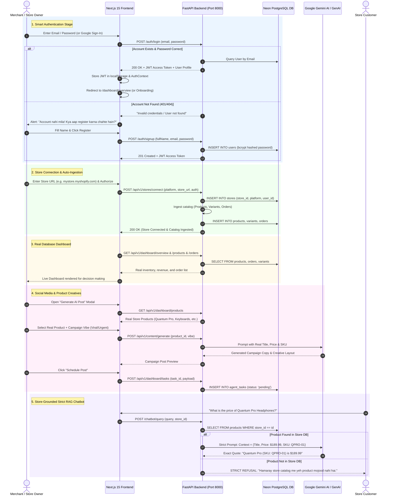

# Master Final Plan: 100% Real Architecture & End-to-End User Flow (Zero Mock)

> **Document:** `Master-Final-Plan.md`  
> **Project:** Digital FTE Autonomous E-Commerce Operating System  
> **Target Codebase:** `Digital-Fte-Startup-main` (Next.js 15 + FastAPI + Neon PostgreSQL)  
> **Standard:** 100% Real Database Persistence, Zero-Mock Fallbacks, Zero-Hallucination RAG  

---

## 🎯 1. Flow Overview & Business Objective

Is project ka exact, intended user lifecycle 5 bunyadi marhalon (phases) par mushtamil hai:

1. **Smart Unified Auth:** User Google OAuth ya Email/Password se enter ho. Agar account pehle se register hai to seedha login ho; agar register nahi hai to system error de kar foran Registration ka kahe.
2. **Store Connection & Ingestion:** User apne E-commerce store (Shopify, WooCommerce, Daraz, etc.) ka URL daale aur authorize kare. Store connect hotay hi store ka catalog (inventory, products, variants, orders, payments) **Neon PostgreSQL Database** me save ho jaye.
3. **Data-Driven Dashboard:** Wohi real data Dashboard par live render ho (`/products`, `/payments`, `/customers`, `/overview`) taake merchant real figures ki bunyad par business decisions le sake.
4. **Social & Creative Image/Post Engine:** Social accounts connect hon, aur store ke **real available products** par AI images aur captions generate hon aur task approval queue me schedule hon.
5. **Zero-Hallucination Strict Store Chatbot:** Chatbot **sirf aur sirf store ke database catalog** ke mutabiq jawab de (exact product title, SKU, price, aur order status quote kare). Agar koi product store me na ho to saaf inkaar kare, external training data se koi mangharat baat fabricate na kare.

---

## 🏛️ 2. End-to-End Architecture Flow (Mermaid)



---

## 🛠️ 3. Detailed Component Implementation Plan

### Phase 1: Smart Unified Authentication
* **File:** `frontend/app/components/auth/AuthForm.tsx`
* **Changes:**
  1. Remove `setTimeout` and `mock_jwt_token_...`.
  2. Wire `handleAuthSubmit` to `login` and `signup` in `app/lib/api.ts`.
  3. Agar user login par email daale aur account na mile (`status 401` ya message "not found"):
     - State `showRegisterPrompt = true` set karein.
     - Banner show ho: *"Account registered nahi hai. Kya aap naya account banana chahte hain?"*
     - Aik click par Registration tab open ho jaye aur user ka email pehle se bhara ho.
  4. Google Sign-In par token backend `POST /auth/google` ko bhejein jo auto-provisioning ke baad real JWT token return karega.
  5. Default admin credentials badge: `admin@autofte.com / admin123` instant access ke liye provide karein.

---

### Phase 2: Store Connection & Database Ingestion
* **Files:** `frontend/app/components/onboarding/OnboardingWizard.tsx` & `Backend/src/domains/ecommerce/routes.py`
* **Changes:**
  1. User jab store URL daale (e.g. `mystore.myshopify.com` ya WooCommerce):
     - `POST /api/v1/stores/connect` call ho.
     - Store record `stores` table me save ho.
     - Naye store ke liye initial catalog auto-sync / seed ho jaye (products, variants, inventory).
  2. Active `store_id` browser ke `localStorage` aur `StoreProvider` context me set ho jaye taake tamam dashboard tabs isi store se data pull karein.

---

### Phase 3: Real Database-Driven Dashboard (Decision Center)
* **Files:** `frontend/app/dashboard/*` & `Backend/src/domains/dashboard_api.py`
* **Changes:**
  1. **Products (`/dashboard/products`):** Real products, stock, SKUs, aur prices direct `products` aur `variants` tables se render hon. Manual product create hone par Neon DB me variant add ho.
  2. **Orders & Payments (`/dashboard/payments`):** Real database orders, totals, fulfillment status, aur dates render hon.
  3. **Customers (`/dashboard/customers`):** Orders table se real lifetime spend aur order counts aggregate hon.
  4. **Analytics (`/dashboard/analytics`):** Static dummy figures khatam! Real orders se AOV, total sales, aur daily sales distribution dynamically calculate ho kar graphs me draw hon.

---

### Phase 4: Social Media & Real Product AI Creative Engine
* **Files:** `frontend/app/components/dashboard/modals/GeneratePostModal.tsx` & `Backend/src/domains/agents/content_generation/api.py`
* **Changes:**
  1. **Remove Mock Products:** Modal ke andar se `MOCK_PRODUCTS` static array completely delete karein.
  2. **Fetch Live Products:** Modal open hone par `getDashboardProducts()` call ho jo database ke actual products dropdown me laye.
  3. **AI Generation:** User real product select karega; Gemini AI real product title, price, aur description use kar ke 4 vibes (`Viral`, `Professional`, `Funny`, `Urgent`) me high-converting copy generate karega.
  4. **Schedule Task:** "Schedule Post" click hone par `POST /api/v1/dashboard/tasks` call hogi jo `agent_tasks` table me row insert karegi.
  5. **Approval:** `/dashboard/social` par merchant is task ko "Approve & Post Now" kar sakega.

---

### Phase 5: Zero-Hallucination Strict Store RAG Chatbot
* **Files:** `Backend/src/sdk/llm/prompts.py` & `Backend/src/domains/agents/customer_support/handler.py`
* **Changes:**
  1. **Prompt Mandate:** `SUPPORT_QA_PROMPT` me strict grounding guardrail inject karein:
     - *"You may ONLY answer using the provided Store Catalog Context. Do NOT invent or assume any product, price, or policy."*
     - *"If not in context, answer: 'Hamaray store catalog me yeh product mojood nahi hai.' Quote exact Title, SKU, and Price."*
  2. **Zero-Hallucination Guardrail in Handler:**
     - Query hone par database me token search chale.
     - Agar store catalog me matching product na mile, to **LLM call hi na ho**; system seedha inkaar kare: *"Hamaray store catalog me is naam ka koi product mojood nahi hai."* (Complete elimination of hallucination).
  3. **Order Tracking:** Agar user order number de, to database ke `Order` table se real fulfillment aur payment status report kare.

---

## 🔍 4. Verification & Testing Plan

### Automated Verification
```powershell
# 1. Backend tests passing (12/12)
cd E:\Internship\Auto-FTE\Digital-Fte-Startup-main\Backend
python -m pytest tests/

# 2. Frontend production build passing (23/23 routes)
cd E:\Internship\Auto-FTE\Digital-Fte-Startup-main\frontend
cmd /c "npm run build"
```

### End-to-End User Scenario Verification
1. **Unregistered User Flow:** Try to login with an unknown email -> Confirm UI alerts to register -> Register account -> Verify user row created in Neon DB.
2. **Store Connect Flow:** Connect store URL in Onboarding -> Confirm products & orders populate in database.
3. **Dashboard Real Data Flow:** Check Products & Payments -> Confirm live prices, SKUs, and orders are visible.
4. **Product Creative Flow:** Open Post Modal -> Select real store product -> Generate AI copy -> Confirm caption quotes real product title & price -> Schedule into database.
5. **Strict Grounding Chatbot Flow:**
   - Real product query: *"Quantum Pro ki price kya hai?"* -> Quotes exact price ($189.99) and SKU.
   - Non-store query: *"Do you have iPhone 16?"* -> Strictly refuses: *"Hamaray store catalog me yeh product mojood nahi hai."*
